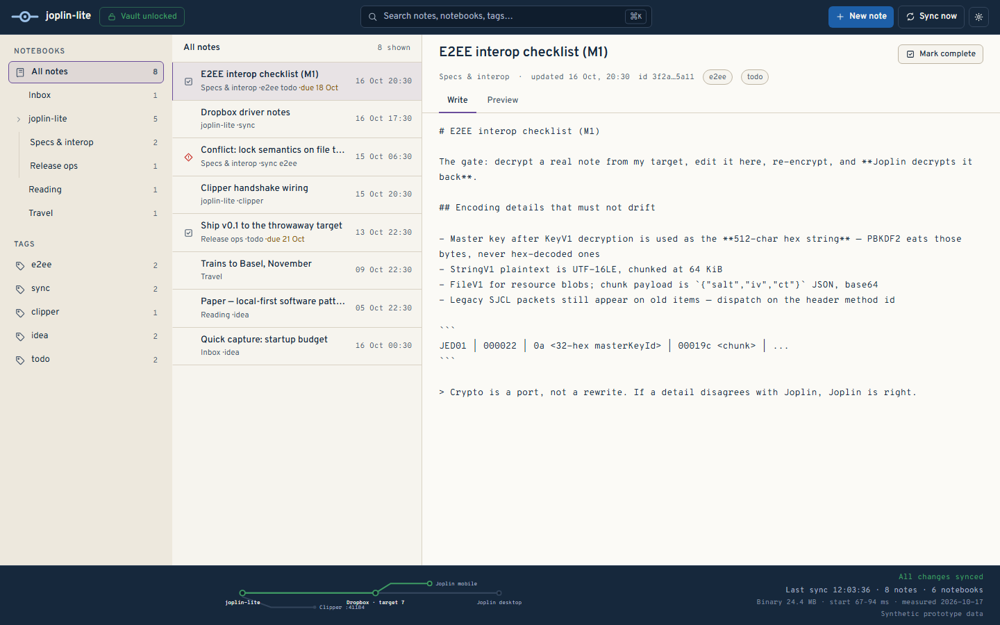
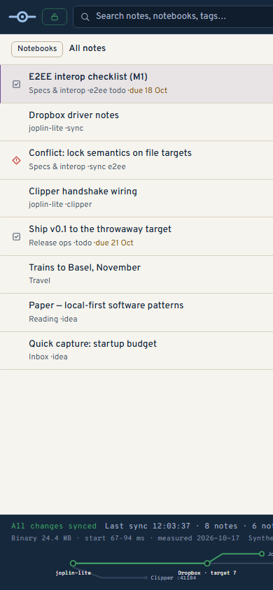

# joplin-lite

A small Go desktop client that is a **real Joplin peer** — E2EE-capable, multi-target
sync, and a Web-Clipper-compatible server — in a single cgo-free binary that starts in
under a second. It shares one library with Joplin desktop and mobile through the sync
target and reads/writes Joplin's item format losslessly.

> Work in progress. The plan lives in [INTENT.md](INTENT.md); the visual system in
> [DESIGN.md](DESIGN.md).

## UI prototype (M4a)

Three-pane workspace — notebooks rail, note list, markdown editor — under a full-width
top bar and status strip, whose signature is the sync line: a Beck-grammar route diagram
of the library's network (joplin-lite → Dropbox → Joplin desktop, with the clipper stub
and the mobile branch).



Below 1024px the shell collapses to single views and the status strip stacks, so the
sync line stays full width.



The prototype runs on synthetic mock data (labeled as such in the status strip). The
footprint figures in the strip are the measured M0 numbers — 24.4 MB binary,
67–94 ms startup (windows/amd64, 2026-10-17) — not placeholders.

## Build & test

Go 1.26+, cgo-free (modernc SQLite):

```sh
CGO_ENABLED=0 go build ./...
CGO_ENABLED=0 go test ./...
```

Web prototype (TanStack Start + React + TS):

```sh
cd web
npm install
npm run dev
```

## Status

- **M0** (headless, cgo-free, lossless baseline) — done: golden-corpus format gate
  green, raw-passthrough serialization, sync engine rehearsed against a local folder
  backend.
- **M1** E2EE interop → **M2** Dropbox sync → **M3** clipper → **M4** shell — see
  [INTENT.md](INTENT.md) for the gates.

## License

AGPL-3.0-or-later, same as the upstream fork
([jescarri/go-joplin](reference/go-joplin)) and Joplin itself.
