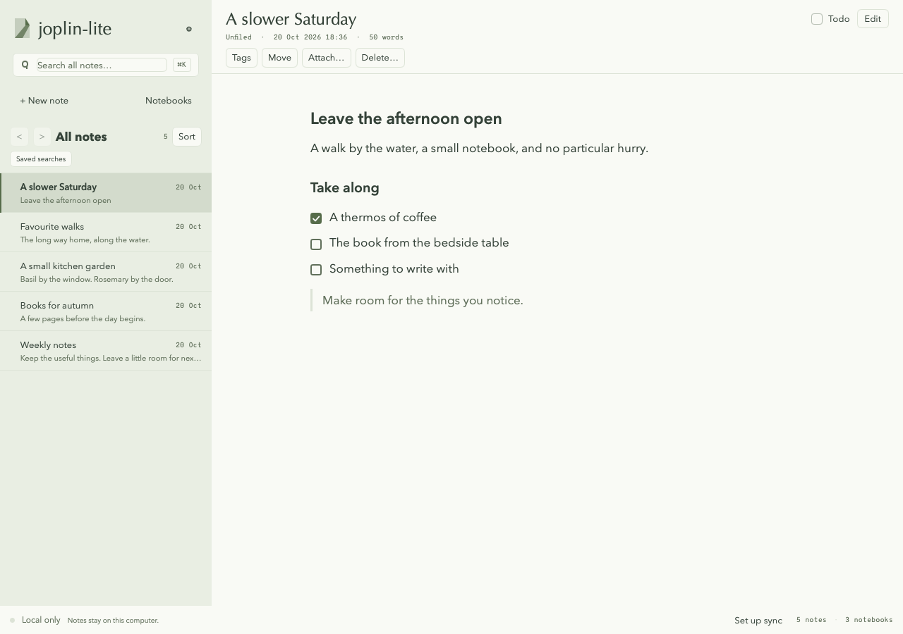
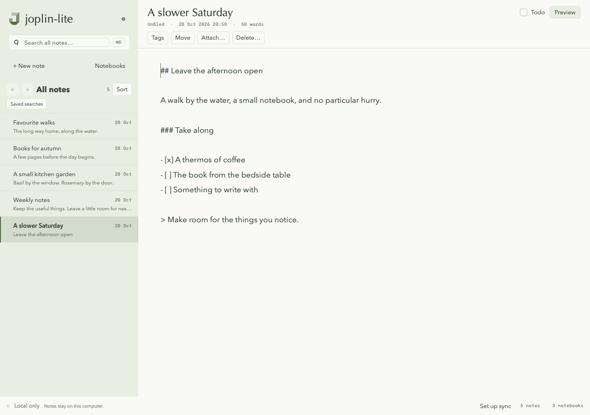
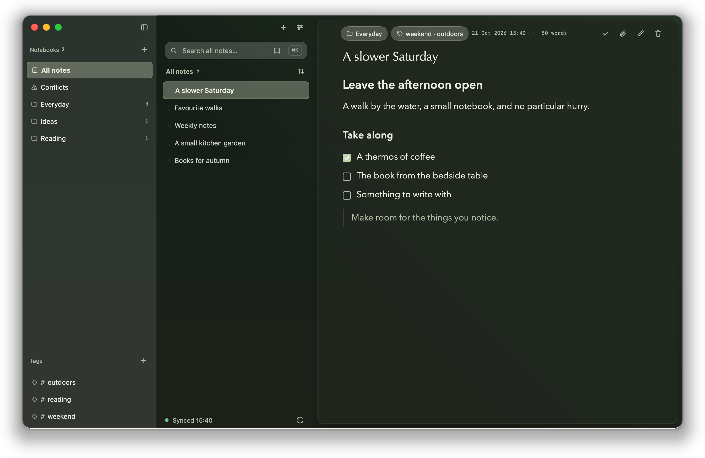
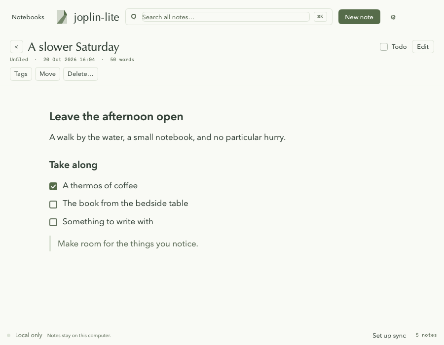

# Joplin Lite

**A quiet, native desktop home for your Joplin notes.**

Built in Go with [MyGO](https://github.com/egoist/mygo), Joplin Lite runs as a single lightweight native app (~120 MB RAM, no Electron or embedded browser) with warm Field Notes paper tones, Liquid Glass surfaces, and a fast, distraction-free Markdown editor.

**[Download v0.1.0-alpha.3](https://github.com/lsj5031/joplin-lite/releases/tag/v0.1.0-alpha.3)** ·
**[Watch the 25s demo film](docs/promo/joplin-lite-promo.mp4)** ·
**[Technical & desktop guide](shell/README.md)**



> **Alpha note:** Joplin Lite is an independent client used daily on macOS and Windows with encrypted Dropbox libraries. Because it is still in alpha and does not cover every official Joplin feature, **always back up your notes** before connecting an existing library.

---

## Quick start

### 1. Download and open

Grab the latest package for your computer from the **[Releases page](https://github.com/lsj5031/joplin-lite/releases/tag/v0.1.0-alpha.3)**:

| Platform | Package | How to run |
| --- | --- | --- |
| **macOS** (Apple silicon) | `Joplin-Lite-0.1.0-alpha.3-macos-arm64.zip` | Unzip and drag **Joplin Lite.app** to **Applications** |
| **Windows** (64-bit, portable) | `Joplin-Lite-0.1.0-alpha.3-windows-amd64.zip` | Extract the whole folder and run **gojoplin-desktop.exe** |

Current source builds use **Joplin Lite.exe** and include the Windows startup
and integrated-window fixes added after alpha.3. The alpha.3 executable predates
those fixes and expects an existing configuration.

* **First launch:** The macOS app is ad-hoc signed (not notarized) and the Windows executable is not publisher-signed, so your OS may ask you to confirm opening it the first time.
* **Default profile:** On Windows, without an explicit config, remembered launch selection, `GOJOPLIN_CONFIG_PATH`, or an existing `~/.config/go-joplin/config.yaml`, the app creates its own empty `{}` config at `%AppData%\joplin-lite\config.json`. Select official Joplin's `settings.json` explicitly with `-config` when needed. macOS retains its existing defaults: go-joplin YAML first, then official Joplin settings. Notes still default to `~/.local/share/gojoplin`; existing explicit, environment and remembered selections still apply.
* **Updating:** There is no background auto-updater. To update, quit Joplin Lite and replace the app or folder—your notes and settings live separately in your user profile directory.

### 2. Try it safely in a local sandbox (no sync required)

Want to explore the interface before connecting your real notes? Launch Joplin Lite with a separate local trial folder that never touches a sync server:

**macOS (Terminal):**

```sh
"/Applications/Joplin Lite.app/Contents/MacOS/Joplin Lite" -no-sync -data-dir "$HOME/Library/Application Support/joplin-lite/try-notes"
```

**Windows (PowerShell, current source build):**

```powershell
& ".\Joplin Lite.exe" -no-sync -data-dir "$env:LOCALAPPDATA\JoplinLite\try-notes"
```

Keep those same flags whenever you want to reopen your trial notebook collection. *(If the local Clipper API port is already taken by another app, pass `-addr 127.0.0.1:41185` — the Web Clipper only scans ports 41184–41193.)*

---

## Made for everyday reading and writing

- **Read first, write when ready.** Existing notes open in a clean, typeset Preview with interactive checklists. Press `Cmd/Ctrl+E` (or click the pencil icon) to edit in Markdown—new notes start ready to type, and your changes save automatically after 500 ms.
- **Jump anywhere from the keyboard.** Press `Cmd/Ctrl+P` (or click `⌘K` in the search bar) to open the **Command & Note Palette**, switch notes instantaneously, toggle appearances, or trigger sync.
- **Stay organized without clutter.** Keep the sidebar focused on your note titles, or open the translucent **Notebooks & Tags** rail (`Cmd/Ctrl+\`) when you want to browse folders, filter by tag, rename inline (`F2` / `Return`), or drag notes into another notebook. Select multiple notes (`Cmd/Ctrl+Click` or `Shift+Click`) to move or delete them in bulk.
- **Attach files & images effortlessly.** Click the paperclip button, drag files straight into the editor, or paste images from your clipboard.
- **Follow `joplin://` links.** Paste an external link such as `joplin://x-callback-url/openNote?id=…` into another app and clicking it brings Joplin Lite forward with that note selected.
- **Resolve sync conflicts safely.** When two devices edit the same note, Joplin Lite shows a side-by-side comparison of both complete versions so you never lose work blindly.
- **Keep portable backups.** Export the whole library to a `.jex` file that Joplin itself can read, or import one back—notes, notebooks, attachments and tags included. See [Backups: JEX export and import](#backups-jex-export-and-import).
- **Make the space yours.** Open **Settings** (`Cmd/Ctrl+,`) to switch between **Light** and **Dark** appearances and choose from four Oklab gradient backdrops (**Sage**, **Linen**, **Mist**, and **Kero**).



### Keyboard shortcuts

| Action | macOS | Windows / Linux |
| --- | --- | --- |
| New note | `Cmd+N` | `Ctrl+N` |
| Search notes | `Cmd+K` or `Cmd+F` | `Ctrl+K` or `Ctrl+F` |
| Command & note palette | `Cmd+P` | `Ctrl+P` |
| Toggle Edit / Preview | `Cmd+E` | `Ctrl+E` |
| Toggle Notebooks rail | `Cmd+\` | `Ctrl+\` |
| Save immediately | `Cmd+S` | `Ctrl+S` |
| Back / Forward in history | `Cmd+[` / `Cmd+]` | `Alt+Left` / `Alt+Right` |
| Inline rename selected item | `Return` or `F2` | `F2` |
| Settings | `Cmd+,` | `Ctrl+,` |





*All screenshots and demo videos are rendered directly from the native UI using synthetic sample notes.*

---

## Connect your existing Joplin library

Joplin Lite can open an official Joplin Desktop profile directly (`database.sqlite` and its `resources/` folder) or sync from scratch into its own profile.

### Opening an existing profile in place

> **Important:** Opening a profile directly edits that SQLite database and adds local history and saved-search tables. **Never run official Joplin and Joplin Lite against the same profile folder at the same time.**

1. **Quit official Joplin** completely and make a full backup copy of your profile folder (including `resources/`).
2. **Start in local-only mode first** so you can inspect your notes and attachments before any sync runs:
   - Point `-data-dir` to your profile directory and include `-no-sync`.
3. **Enable sync when you are satisfied.** Configure your target in Settings (`Cmd/Ctrl+,`) or your config file.

On **macOS**, you can also configure a remembered Finder launch file (`~/Library/Application Support/joplin-lite/launch.json`) that reopens your chosen profile automatically and reads your existing official Dropbox token and E2EE master password directly from **macOS Keychain**—keeping recovered secrets in memory only. See **[Remembered native startup & Keychain reuse](shell/README.md#remembered-native-startup)** for setup details. *(Outside Keychain reuse mode, passwords saved in Joplin Lite's Settings dialog are stored unencrypted in its local SQLite table.)*

---

## Sync options

| Sync target | Where to configure | Status & test coverage |
| --- | --- | --- |
| **Dropbox** | Config file / existing credentials | Used daily on macOS & Windows with encrypted libraries; interoperates with official Joplin mobile & desktop |
| **Joplin Server** | In-app Settings (`Cmd/Ctrl+,`) | Plaintext and end-to-end encrypted (E2EE) integration tests |
| **Local folder** | In-app Settings (`Cmd/Ctrl+,`) | Plaintext and E2EE round-trip integration tests |
| **Amazon S3 / S3-compatible** | Config file (build with `-tags s3`) | Integration-tested; omitted from standard prebuilt downloads to keep binaries small |

*OneDrive is not currently supported. Authorizing a brand-new Dropbox connection uses your own Dropbox OAuth app key—see [`config.yaml.example`](config.yaml.example) and the [desktop guide](shell/README.md).*

### Smart, safe Dropbox sync

- **Incremental delta sync:** Joplin Lite saves its Dropbox cursor across restarts, so subsequent syncs only fetch changed items instead of scanning your whole vault.
- **Content-hash reuse:** Existing local metadata and attachments are verified against Dropbox's content hash and reused without re-downloading.
- **Clear status in the sidebar footer:** Always see whether you are **Local only**, **Checking items**, **Synced**, **Offline**, or waiting on another device's sync lock, alongside the last successful sync time.
- **Optional deletion guard:** Setting `sync.dropbox.block_deletes: true` in YAML prevents outgoing remote deletions while you test. Turn it off when you want local note deletions to sync to Dropbox.

---

## Backups: JEX export and import

JEX is Joplin's own lossless export format, so archives move in either direction between Joplin Lite and official Joplin. In the app, use **File ▸ Export All Notes (JEX)…** and **File ▸ Import JEX Archive…**; the same work is available from the command line:

```sh
# every note, notebook, attachment, tag and tag link
./gojoplin export jex ~/JoplinBackup/all-2026-10-22.jex --data-dir ~/.config/joplin-desktop

# see what an archive holds without writing anything
./gojoplin import jex ~/JoplinBackup/all-2026-10-22.jex --dry-run --data-dir /tmp/try-notes

# import it (optionally into one existing notebook instead of its own tree)
./gojoplin import jex ~/JoplinBackup/all-2026-10-22.jex --data-dir /tmp/try-notes [--notebook <id>]
```

Build the command-line binary with `go build -o gojoplin .` from the repository root. `--force` overwrites an existing export target, and `--data-dir` chooses the profile, so an import can be rehearsed in a throwaway directory first.

What to expect:

- **Exports are atomic.** The archive is built beside the target and renamed only when complete, so an interrupted run never leaves a truncated file that looks like a backup.
- **Imports read before they write.** The archive is parsed and its note, notebook and attachment counts are reported before anything changes; a failure leaves the library untouched. In the app this is the confirmation dialog—nothing is written until you approve it.
- **Imported items get new ids.** Notebook parents, attachment references in note bodies, and tag links are remapped to them, but importing the same archive twice adds a second copy instead of merging. Created and updated times come from the archive, so date-sorted lists keep their original order.
- **Archives are plain text.** JEX is an uncompressed tar of `<id>.md` items plus `resources/<id>.<extension>` blobs, so note bodies and attachment bytes are readable without a password—exactly as in official Joplin. Treat a backup file like the notes it contains.
- **A few Joplin-only fields are not carried.** `is_locked`, `extracted_resource_ids`, and resource OCR metadata are omitted on export and fall back to Joplin's defaults on import. Attachments whose blobs are still end-to-end encrypted are exported as metadata only, since their ciphertext cannot be restored as usable plaintext.

---

## Good to know

- **Keep regular backups** while Joplin Lite is in alpha. Fresh-account onboarding, OAuth token renewal, screen-reader accessibility, and live browser-extension pairing for the built-in Clipper API still need broader testing.
- **First sync on large vaults:** An initial sync or full cursor reset on a large library can take time; see the [Dropbox sync performance notes](docs/dropbox-sync-review.md).
- **Troubleshooting & logs:** Diagnostic logs are written to `desktop.log` inside your active data directory (automatically rotated at 1 MiB). When [opening an issue](https://github.com/lsj5031/joplin-lite/issues), include the app version and relevant error lines with personal note titles, paths, and tokens removed.

---

## Build from source

Requires **Go 1.27+** (`go1.27.1` is pinned and fetched automatically via `GOTOOLCHAIN=auto`). No Node.js or frontend build step is needed for the native desktop app.

```sh
git clone https://github.com/lsj5031/joplin-lite.git
cd joplin-lite
bash shell/build.sh          # builds tmp/Joplin Lite.exe
bash shell/bundle.sh         # macOS: packages tmp/Joplin Lite.app
go test ./...
(cd shell && go test ./...)
```

See [`shell/README.md`](shell/README.md) for Windows portable packaging, headless UI screenshot/video generation, and the optional browser preview. Additional testing guides cover [local sync](docs/local-sync-test.md), [E2EE sync](docs/e2ee-sync-rehearsal.md), [Joplin Server](docs/joplin-server-test.md), and [S3](docs/s3-test.md).

## License

[AGPL-3.0-or-later](LICENSE). Forked from [jescarri/go-joplin](https://github.com/jescarri/go-joplin); see [NOTICE](NOTICE).

Dependencies retain their own licenses. [THIRD_PARTY_NOTICES.md](THIRD_PARTY_NOTICES.md)
contains the native dependency, embedded-font, and historical tooling notices;
browser builds emit their own notice bundle. Overpass fonts remain under SIL
OFL-1.1. The current folded-J artwork was created for this project.

Redistributed binaries must include the license/notices and corresponding
source for that build, including build scripts and pinned dependency manifests.
Release tags provide matching source for released binaries. Modified networked
versions must offer users the source as required by the AGPL.
