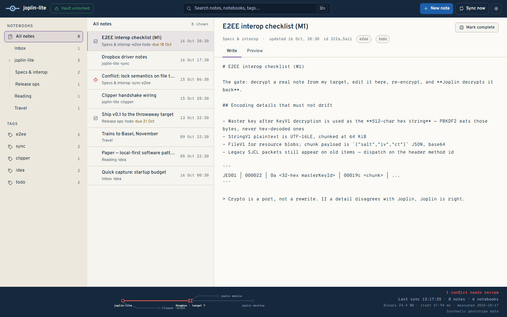
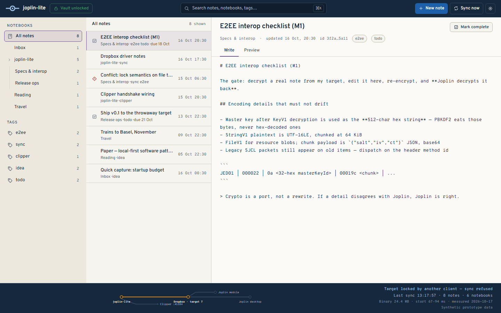

# joplin-lite

A small Go desktop client that is a **real Joplin peer** — E2EE-capable, multi-target
sync, and a Web-Clipper-compatible server — in a single cgo-free binary that starts in
under a second. It shares one library with Joplin desktop and mobile through the sync
target and reads/writes Joplin's item format losslessly.

> Work in progress. The plan lives in [INTENT.md](INTENT.md); the visual system in
> [DESIGN.md](DESIGN.md).

## UI prototype (M4a)

Three-pane workspace — notebooks rail, note list, markdown editor — under a full-width
top bar and status strip, whose signature is the sync line: a Beck-grammar route diagram
of the library's network (joplin-lite → Dropbox → Joplin desktop, with the clipper stub
and the mobile branch).


Below 1024px the shell collapses to single views and the status strip stacks, so the
sync line stays full width.


Sync states are addressable for captures (`/?state=conflict`, `/?state=locked` — the same
states as the settings popover preview). A conflict marks the target station with a
disruption cross; a lock held by another client turns the line amber and refuses the sync.





The prototype runs on synthetic mock data (labeled as such in the status strip). The
footprint figures in the strip are measured: 16.4 MB for the default binary (Dropbox /
Joplin Server; rebuild with `-tags s3` for the S3 target, 24.6 MB) and 74–133 ms startup
(windows/amd64, 2026-10-17, `go build -trimpath -ldflags="-s -w"`) — not placeholders.

## Build & test

Go 1.26+, cgo-free (modernc SQLite):

```sh
CGO_ENABLED=0 go build ./...
CGO_ENABLED=0 go test ./...
```

Web UI (TanStack Start + React + TS, built as a **static SPA**):

```sh
cd web
npm install
npm run dev      # dev server on :3000
npm run build    # static artifact in web/dist/client (index.html + assets)
```

`npm run build` emits a directory of static files with an `index.html` fallback for
client-side routes — there is no Node/Nitro server in production. During development
the UI talks to the local clipper API (`VITE_GOJOPLIN_URL`, `VITE_GOJOPLIN_TOKEN`).

### Desktop app

The desktop app in [`shell/`](shell/README.md) is native: it draws the workspace
with MyGO `ui` and starts the clipper API in the same process. It embeds no
browser and no frontend bundle:

```sh
bash shell/build.sh
./tmp/gojoplin-desktop.exe -config tmp/try-config.yaml -no-sync
```

Go 1.27+ (pinned via the toolchain) is the only extra requirement; the MyGO CLI
is not needed and WebView2 is never started. Closing the window stops the server
and closes SQLite.

Packaging: Windows is a portable zip (`bash shell/package-windows.sh`, icon and
version block included) and macOS an `.app` bundle (`bash shell/bundle.sh`).
There is no installer, by decision.

The web build is still available as an optional browser preview over the same
vault, served from disk rather than embedded:

```sh
cd web && npm run build
cd .. && go build -o tmp/gojoplin.exe .
./tmp/gojoplin.exe serve --config tmp/try-config.yaml --no-sync --web-dir web/dist/client
# open http://127.0.0.1:41185 (API stays on the configured port)
```

For a safe end-to-end E2EE and sync rehearsal against Joplin desktop's File
system target, see [docs/local-sync-test.md](docs/local-sync-test.md); the
remote targets have their own gates in
[docs/joplin-server-test.md](docs/joplin-server-test.md) and
[docs/s3-test.md](docs/s3-test.md). The migration record and the measured
numbers are in [docs/native-ui-migration.md](docs/native-ui-migration.md).

For initial Dropbox dogfooding, add deletion protection alongside the existing
authentication configuration:

```yaml
sync:
  target: 7
  dropbox:
    block_deletes: true
```

The equivalent JSON setting is `"sync.7.blockDeletes": true`. This blocks remote
note and attachment deletions, reports an error, and keeps them queued. Uploads,
edits, and sync-lock cleanup still work. Deletions remain blocked until you
explicitly remove this protection; it is not a read-only mode.

## Status

- **M0** (headless, cgo-free, lossless baseline) — done: golden-corpus format gate
  green, raw-passthrough serialization, sync engine rehearsed against a local folder
  backend.
- **M1** (E2EE) / **M2** (Dropbox sync) / **M3** (clipper) — code complete and tested
  against fakes and local rehearsals; the real-target gates (Joplin desktop decrypts,
  Dropbox round-trip, extension clip) are still ahead.
- **M4** — the `service/` typed seam (notes, notebooks, tags, search, conflicts, settings)
  is in, and `shell/` is a native MyGO desktop app over it: notebooks, notes, tags,
  search, conflicts, sync state and a native settings dialog, with the clipper/Data API
  in the same process and no browser engine. Windows ships as a portable zip and macOS
  as an `.app` bundle. The remote round trips pass against real targets in Docker —
  Joplin Server (plaintext and E2EE) via `qa/joplin-server-e2e.sh`, S3 via `qa/s3-e2e.sh`;
  remaining for the gate: extension pairing, Dropbox, and a signed macOS bundle run. See
  [INTENT.md](INTENT.md).

## License

AGPL-3.0-or-later, same as the upstream fork
([jescarri/go-joplin](reference/go-joplin)) and Joplin itself.
